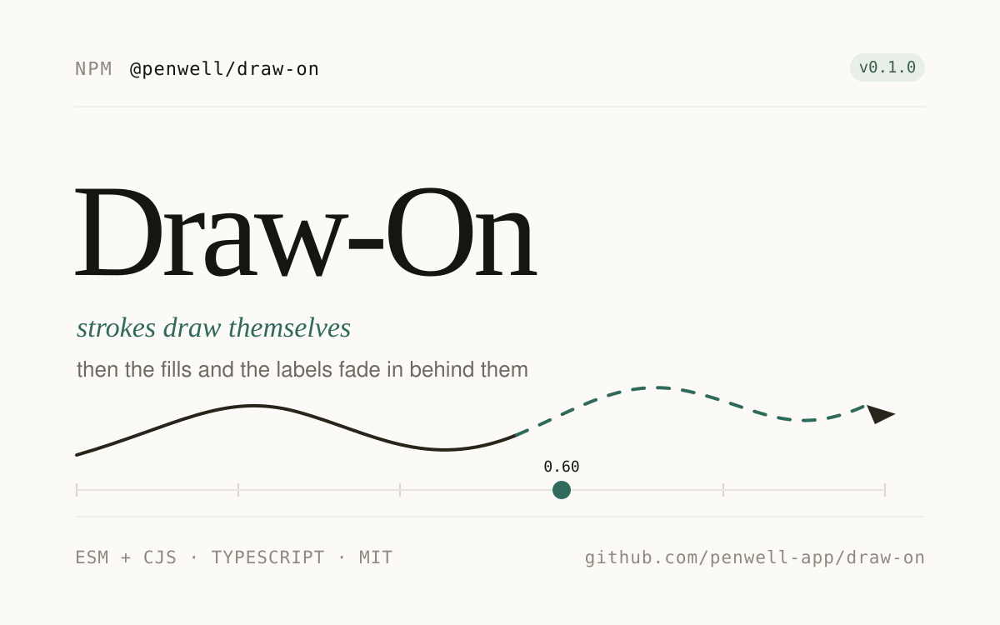
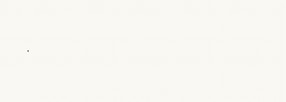
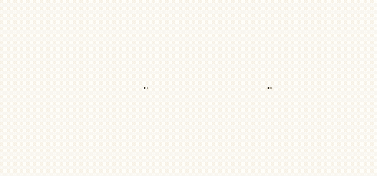
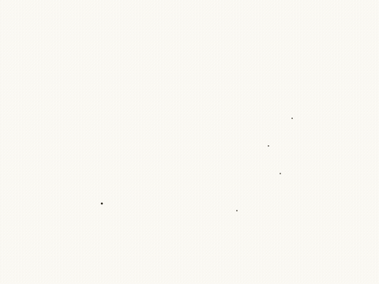

<div align="center">
  
  <h1>@penwell/draw-on</h1>
  <p><strong>Make any inline SVG draw itself.</strong></p>
  <p>Strokes animate one by one, then fills and labels fade in. Scrub to any point, or record the whole animation to a WebM clip - entirely in the browser, without a server.</p>
  
  [](https://www.npmjs.com/package/@penwell/draw-on)
  [](https://www.npmjs.com/package/@penwell/draw-on)
  [](https://github.com/penwell-app/draw-on/blob/master/LICENSE)
</div>

---

Zero dependencies. Handles the SVGs real apps ship: `<use>`/`<symbol>` sprites, fill-only shapes, `<text>` labels, CSS-styled paths, `pathLength`, dashed lines.

Originally created for [Penwell](https://usepenwell.com/) to animate Mermaid diagrams and handwritten notebook pages, `@penwell/draw-on` is now available as a standalone open-source library.

## 📺 Demo Videos

<div align="center">
  
### Annotate Documents


### Draw Diagrams


### Notebook Animation


### Full Video Demos

- [Penwell Draw On Demo](https://github.com/penwell-app/draw-on/raw/master/penwell-drawon-demo.mp4)
- [Practical MP4 Demo](https://github.com/penwell-app/draw-on/raw/master/drawon_demo_vid.mp4)
- [WebM Demo](https://github.com/penwell-app/draw-on/raw/master/draw-on-demo.webm)

### Demo Folder in Github

- [Demo Folder in Github](https://github.com/penwell-app/draw-on/tree/master/demos)

</div>

---

## 📖 Documentation

<a href="https://draw-on-nu.vercel.app/" target="blank"><strong>Documentation Production Website - https://draw-on-nu.vercel.app/</strong></a>

The full documentation site lives in [`website/`](./website) and covers everything in this README in more depth, with live demos you can replay, scrub and record, and a playground for your own SVG.

- **Start here** - [Introduction](https://github.com/penwell-app/draw-on/blob/master/website/src/content/docs/introduction.mdx), Installation, Quickstart, How it works
- **Guides** - React, Vanilla JS and TypeScript, scrubbing and scroll, recording to WebM
- **Recipes** - Mermaid, Excalidraw and tldraw, Figma and handwriting, preparing your SVGs
- **Reference** - `createDrawing`, `DrawingOptions`, `useSketchDraw`, `SketchDraw`, `parseSvg`, `computeDims`, the recording API, constants and types
- **Playground** - Paste any inline SVG, tune the real options, copy the generated code

Run it locally:

```bash
cd website
npm install
npm run dev        # http://localhost:5180
```

The site imports this package straight from `src/`, so every demo runs the code in your working tree.

---

## Features

- **Zero dependencies**, tree-shakeable, ESM + CJS, SSR-safe imports
- **Works on real SVGs**: resolves `<use>`, `<symbol>` and shared paths (including sprites defined elsewhere on the page), respects `viewBox`/`preserveAspectRatio`, `pathLength`, CSS-styled strokes
- **Fill-only shapes get an outline** to draw, then fills and labels fade in
- **No stray dots**: round line caps stay hidden until their stroke starts
- **Timing in milliseconds**, 8 easings or your own function, 5 ordering modes including `stagger` and constant pen `speed`
- **Full playback control**: promise-based `play()`, `pause`, `resume`, `reverse`, `seek`, `loop`, `yoyo`, `playbackRate`, events
- **Per-element control** in markup: `data-draw-order`, `data-draw-skip`
- **Pen nib** that rides the tip of the stroke, **hand-drawn (sketchy) mode**, **typewriter labels**
- **Export a CSS-only animated SVG** that plays in ``, GitHub READMEs, Notion and email: no JavaScript needed
- **Scroll scrubbing** and **in-view triggers** built in
- **Record to WebM** or render **PNG frames** in the browser, no server or ffmpeg
- **React** (`<DrawOn>`, `useDrawOn`), **Web Component** (`<draw-on>`) for Vue, Svelte, Angular, Astro and plain HTML
- **Presets** for diagrams, icons, logos, signatures and sketches
- Respects `prefers-reduced-motion`; `destroy()` restores the SVG exactly
- Parsed markup is sanitized (scripts, event handlers and `javascript:` links removed)

## Installation

```bash
npm install @penwell/draw-on
```

React is an optional peer dependency. Entry points:

| Import | Contents |
| --- | --- |
| `@penwell/draw-on/core` | Framework-free engine (recommended for non-React apps) |
| `@penwell/draw-on/react` | `<DrawOn>`, `useDrawOn` (and the v0 `SketchDraw`, `useSketchDraw`) |
| `@penwell/draw-on/element` | `defineDrawOn()` for the `<draw-on>` custom element |
| `@penwell/draw-on` | Everything above, for backwards compatibility |

No build step? Use a CDN:

```html
<script type="module">
  import { draw } from 'https://esm.sh/@penwell/draw-on/core';
  draw('#logo');
</script>
```

## Quick start

### Vanilla

```ts
import { draw } from '@penwell/draw-on/core';

const drawing = draw('#logo', { duration: 1800, type: 'stagger' });
await drawing.play();       // resolves when finished
drawing.reverse();          // undraw
drawing.seek(0.5);          // scrub
drawing.destroy();          // stop and restore the original SVG
```

Load markup or a file:

```ts
import { mount } from '@penwell/draw-on/core';

const drawing = await mount('#hero', '/diagram.svg', { reveal: 'stroke' });
```

### React

```tsx
import { DrawOn } from '@penwell/draw-on/react';
import Logo from './logo.svg?react';

<DrawOn trigger="inView" type="stagger"><Logo /></DrawOn>
<DrawOn src="/diagram.svg" reveal="stroke" />
<DrawOn svg={mermaidMarkup} duration={3000} />
<DrawOn progress={scrollProgress}><Logo /></DrawOn>   {/* controlled */}
```

Imperative control with a ref:

```tsx
const ref = useRef<DrawOnHandle>(null);
<DrawOn ref={ref} trigger="manual"><Logo /></DrawOn>
<button onClick={() => ref.current?.restart()}>Replay</button>
```

Or the hook, for your own markup:

```tsx
import { useDrawOn } from '@penwell/draw-on/react';

function Signature() {
  const { ref, status, restart } = useDrawOn<HTMLDivElement>({ type: 'speed', pen: true });
  return <div ref={ref} onClick={restart}><svg>{/* … */}</svg></div>;
}
```

Triggers: `auto` (default), `inView`, `hover`, `click`, `manual`. A numeric `progress` prop overrides the trigger. The drawing rebuilds when `svg`, `src`, any primitive option or `rebuildKey` changes. Safe under StrictMode.

### Web Component (Vue, Svelte, Angular, Astro, HTML)

```ts
import { defineDrawOn } from '@penwell/draw-on/element';
defineDrawOn();
```

```html
<draw-on src="/logo.svg" trigger="inView" type="stagger" duration="2000"></draw-on>

<draw-on preset="signature" pen>
  <svg viewBox="0 0 200 80">…</svg>
</draw-on>
```

Attributes mirror the options in kebab-case (`stroke-ease`, `reveal-start`, `no-outline`, …) plus `preset`. Methods: `play()`, `restart()`, `reverse()`, `pause()`, `seek()`. Events: `draw-start`, `draw-progress`, `draw-complete`, `draw-error`.

## Recipes

### `<use>`, `<symbol>` and icon sprites

Nothing to configure. Each `<use>` is swapped for an inline copy of what it references before measuring, including sprites defined in another `<svg>` on the page. `destroy()` puts the original `<use>` back.

```html
<svg viewBox="0 0 24 24"><use href="#icon-rocket" /></svg>
```

### Animated SVG for READMEs, docs and email

```ts
import { toAnimatedSVG, downloadBlob } from '@penwell/draw-on/core';

const file = toAnimatedSVG(markup, { duration: 2500, type: 'stagger' });
downloadBlob(new Blob([file], { type: 'image/svg+xml' }), 'logo-animated.svg');
```

The output animates with CSS keyframes only and respects reduced motion. Commit it and use `` in a README.

### Scroll-linked drawing

```ts
import { draw, scrollScrub, inView } from '@penwell/draw-on/core';

const chart = draw('#chart', { autoplay: false });
const stop = scrollScrub(chart, { start: 0.9, end: 0.3 });

const logo = draw('#logo', { autoplay: false });
inView(logo.el, () => logo.play());
```

### Presets

```ts
import { draw, presets } from '@penwell/draw-on/core';

draw('#diagram', presets.diagram);                 // Mermaid, Excalidraw, draw.io
draw('#icon', presets.icon);                       // Lucide, Heroicons, Feather
draw('#brand', { ...presets.logo, duration: 3000 });
draw('#name', presets.signature);                  // constant speed + pen nib
draw('#board', presets.sketch);                    // wobbly strokes, typed labels
```

### Control order in markup

```html
<g data-draw-order="1">…drawn first…</g>
<g data-draw-order="2">…then this…</g>
<path data-draw-skip d="…" />  <!-- never animated -->
```

### Hand-drawn look and pen nib

```ts
draw('#board', { sketchy: { roughness: 1.5, seed: 7 }, pen: { radius: 4, color: '#e11d48' } });
```

### Labels typed out

```ts
draw('#diagram', { text: 'type' });
```

## Recording

```ts
import { draw, computeDims, canRecordVideo, recordDrawToWebM, recordFrames, downloadBlob } from '@penwell/draw-on/core';

const drawing = draw(svg, { autoplay: false });
const { width, height } = computeDims(drawing.el);

if (canRecordVideo()) {
  const blob = await recordDrawToWebM(drawing.el, drawing.setProgress, { width, height, durationMs: 4000, scale: 2 });
  downloadBlob(blob, 'diagram.webm');
}

// Transparent PNG frames, rendered as fast as possible (not real time)
const frames = await recordFrames(drawing.el, drawing.setProgress, { width, height, fps: 30 });
```

External `<image>` sources are embedded automatically (`inlineImages: false` to opt out). WebM needs `MediaRecorder` and `canvas.captureStream()`; Chromium is most reliable. Gate UI behind `canRecordVideo()`.

## API

### `draw(target, options?)`

`target` is an `<svg>`, an element containing one, or a selector. Returns a `Drawing`:

| Member | Description |
| --- | --- |
| `play()` | Draw forward. Resolves `true` when finished, `false` if interrupted |
| `reverse()` | Undraw back to the start |
| `restart()` | Rewind and play |
| `pause()` / `resume()` | Pause and continue in the current direction |
| `seek(fraction)` / `seekTime(ms)` | Jump without changing play state |
| `setProgress(fraction)` | Alias of `seek`, for recorders |
| `reset()` | Pause and rewind to blank |
| `progress` | Current position 0 to 1; assign to seek |
| `playbackRate` | Speed multiplier, live |
| `duration`, `playing`, `stats`, `el` | Read-only state; `stats` counts strokes, fills, texts and resolved `<use>` |
| `on(event, fn)` | `'start' \| 'progress' \| 'pause' \| 'complete'`; returns an unsubscribe function |
| `destroy()` | Stop and restore the SVG exactly |

### Options

| Option | Default | Description |
| --- | --- | --- |
| `duration` | `2000` | Total length in ms (ignored by `type: 'speed'`) |
| `type` | `'oneByOne'` | `'oneByOne'`, `'delayed'`, `'sync'`, `'stagger'`, `'speed'` |
| `stagger` | `80` | Gap between stroke starts in ms, for `stagger` |
| `speed` | `400` | Pen speed in user units per second, for `speed` |
| `delay` | `0` | Wait before drawing, in ms |
| `ease` | `'easeOutCubic'` | Easing over the whole timeline: name or `(t) => t` |
| `strokeEase` | `'linear'` | Easing inside each stroke |
| `stroke` | `'#27241a'` | Outline colour for fill-only shapes |
| `strokeWidth` | `'1.25'` | Outline width for fill-only shapes without one |
| `outline` | `true` | Give fill-only shapes an outline to draw |
| `reveal` | `'end'` | Fills: `'end'` (together), `'stroke'` (each behind its stroke), `'none'` |
| `revealStart` | `0.6` | For `reveal: 'end'`, progress where fills and labels begin |
| `text` | `'fade'` | Labels: `'fade'`, `'type'`, `'none'` |
| `loop` | `false` | `true` forever, or a number of extra repeats |
| `yoyo` | `false` | Undraw on alternate loops |
| `playbackRate` | `1` | Speed multiplier |
| `autoplay` | `true` | Start immediately |
| `reducedMotion` | `'respect'` | Jump to the end when the user prefers reduced motion; `'ignore'` to always animate |
| `pen` | `false` | `true` or `{ radius, color, element }` |
| `sketchy` | `false` | `true` or `{ roughness, seed, step }` |
| `onStart`, `onProgress`, `onComplete` | | Callbacks |

Easings: `linear`, `easeIn`, `easeOut`, `easeInOut`, `easeOutCubic`, `easeInOutCubic`, `easeOutQuart`, `easeOutBack`.

### Other exports

- `mount(container, markupOrUrlOrSvg, options)`: insert then `draw()`; resolves to a `Drawing`
- `parseSvg(markup)` / `loadSvg(url)` / `sanitizeSvg(el)`: parse and sanitize; throws `InvalidSvgError`
- `computeDims(svg, maxWidth?)`: intrinsic size for video output
- `toAnimatedSVG(svgOrMarkup, options)`: CSS-only animated SVG string
- `scrollScrub(drawing, options)`, `inView(el, onEnter, options)`: return cleanup functions
- `presets`, `easings`, `SHAPE_SELECTOR`, `TEXT_SELECTOR`, `NON_RENDERED_SELECTOR`, `isPaint`

## Migrating from 0.x

Nothing breaks: `createDrawing`, `useSketchDraw` and `SketchDraw` still work and now run on the new engine, so `<use>`/`<symbol>` SVGs and the stray-dot fix apply to them too. They are deprecated in favour of:

| 0.x | 1.x |
| --- | --- |
| `createDrawing(svg, { duration: 220 })` (frames) | `draw(svg, { duration: 3667 })` (ms) |
| `drawing.play(onDone)` | `await drawing.play()` |
| `drawing.stop()` | `drawing.pause()` |
| `useSketchDraw({ svgMarkup })` | `useDrawOn({ svg })` |
| `<SketchDraw svgMarkup={…}>` | `<DrawOn svg={…}>` or `<DrawOn><svg/></DrawOn>` |
| `import … from '@penwell/draw-on'` | `…/core`, `…/react` or `…/element` |

Behaviour changes: Vivus is gone, so shapes are no longer rewritten as `<path>`, and `destroy()` restores the SVG. Parsed markup is sanitized. The compat `revealMs` now eases the whole drawing to its end.

## Contributing

Contributions are welcome! ❤️

Whether you want to fix a bug, improve browser compatibility, add a feature, improve documentation, or suggest an idea, feel free to contribute.

### Getting started

Clone the repository:

```bash
git clone https://github.com/penwell-app/draw-on.git
cd draw-on
```

Install dependencies:

```bash
npm install
```

Run type checking:

```bash
npm run typecheck
```

Build the package:

```bash
npm run build
```

### Pull requests

1. Fork the repository or create a branch from `master`.
2. Make your changes.
3. Run the type checker and build.
4. Update documentation when necessary.
5. Commit your changes.
6. Open a pull request with a clear description of what changed and why.

For larger changes, opening an issue first is encouraged so we can discuss the approach before implementation.

### Good first contributions

Some areas where contributions are especially welcome:

- 🐛 Bug fixes
- 🌐 Cross-browser compatibility
- 🎥 Video recording improvements
- ⚡ Performance improvements
- 🧪 Test coverage
- 📚 Documentation improvements
- 🎨 SVG compatibility improvements
- 💡 New animation or reveal capabilities

Please keep pull requests focused and avoid unrelated changes.

## Development

The project uses:

- TypeScript
- React (optional peer dependency)
- tsup
- ESM + CommonJS builds

Build the package:

```bash
npm run build
```

Run TypeScript checks:

```bash
npm run typecheck
```

Watch the package during development:

```bash
npm run dev
```

## Important implementation notes

### SVG mutation

`draw()` edits the SVG in place (inline styles, inlined `<use>` copies) and records every change. `destroy()` undoes them, so nodes owned by React or Vue stay intact.

`toAnimatedSVG()` works on a clone and never touches the source.

### CSS that targets `<use>`

Inlined `<use>` copies become `<g data-draw-on-use="#id">`. Stylesheet rules that select `use` directly will not match while the drawing is alive.

### External stylesheets and fonts

SVGs referencing external stylesheets or fonts may not rasterize correctly during WebM recording. External `<image>` sources are embedded automatically; inline styles and fonts where possible.

## Used by Penwell

`@penwell/draw-on` was originally built as part of [Penwell](https://usepenwell.com/) to animate Mermaid diagrams and handwritten notebook pages.

It is now available as a standalone open-source library for developers who want to add draw-on animations to their own SVG-based experiences.

## License

MIT © 2026 Pratik Tomar